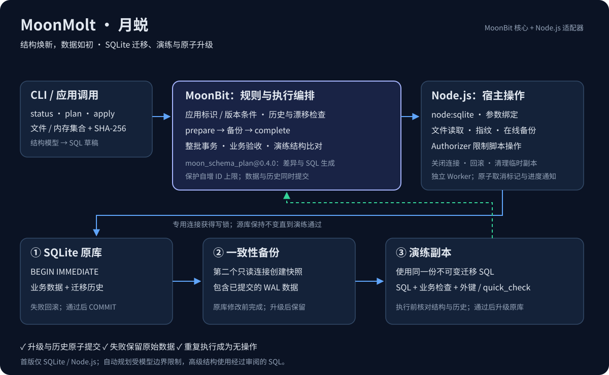

<p align="center"></p>

# MoonMolt · 月蜕

**结构焕新，数据如初。**

MoonMolt 是用 MoonBit 编写的 SQLite 迁移库与 CLI。适用于桌面应用、本地工具和小型服务：升级前保留一致性备份，在副本上演练，再用一个事务执行整批迁移。迁移脚本、历史记录和结构指纹共同决定数据库能否继续升级。

首版运行在 Node.js ≥24.10.0，无 npm 运行时依赖。MoonBit 工具链仅用于源码构建；尚未发布 npm 或 Mooncakes 包。

## 快速开始

安装 [MoonBit 工具链](https://www.moonbitlang.com/download/) 和 Node.js 后：

```sh
git clone https://github.com/q0w1ertyuiop/MoonMolt.git
cd MoonMolt
npm run build
npm run demo
```

演示实际创建用户、订单数据库，增加订单状态并回填、建立索引、重建用户表；中途加入错误迁移，检查原有数据和历史仍完整，再修正并重试。脚本带断言，不需要提前准备数据库。[本次实际运行结果](docs/demo-report.json)记录了输入、输出和环境。

## 在应用中使用

迁移目录中的 SQL 文件采用六位正整数版本号，名称允许字母、数字、下划线与连字符：

```text
migrations/
  000001_order_status.sql
  000002_order_index.sql
  000003_required_user_name.sql
```

```sh
node node/cli.mjs inspect --db app.db --format json
node node/cli.mjs status --db app.db --dir migrations
node node/cli.mjs rehearse --db app.db --dir migrations
node node/cli.mjs apply --db app.db --dir migrations --to 2
node node/cli.mjs apply --db app.db --dir migrations --rebuild
```

版本按数字排序，允许间隔，禁止重复。SHA-256 根据文件原始字节计算，包括注释和换行；已经执行的文件必须保持原样，历史必须是当前目录的完整前缀。数据库不存在时仅 `apply --create` 可以创建它。再次执行已完成的迁移会成为无操作，不新增备份。

已有但未使用迁移工具的数据库：把适合其当前结构的**第一项升级**编号为 `000001`。首次执行会在同一事务中创建历史表。用于全新数据库的目录应包含建表迁移；不要把旧库已经执行过的建表文件直接作为其待执行目录，工具不会自动把这些文件标记为已执行。

也可以在 Node.js 应用中复用同一个引擎。源码构建后使用本地入口，打包安装后使用 `import { run, plan } from 'moonmolt'`：

```js
import { run } from './node/runtime.mjs';
const report = await run({
  command: 'apply', db: 'app.db', dir: 'migrations',
  busy_timeout_ms: 5000,
  // backup_dir: '/path/to/application-backups',
});
if (!report.ok) throw new Error(`${report.kind}: ${report.message}`);
```

`run` 串行处理同一 JavaScript 上下文中的调用；Worker 或跨进程并发通过 SQLite 写锁协调。MoonBit 用户可复用根包的 `load_migrations`、`validate_history`、`plan`，或实现 `Driver` 调用 `prepare`／`complete`。接口见 [pkg.generated.mbti](pkg.generated.mbti)，宿主操作约定见 [执行协议](docs/engine.md)。目前根包使用本地开发模块标识，不代表已在 Mooncakes 注册。

库调用在入队前固定参数并解析绝对路径，调用后修改原对象或工作目录不会改变迁移目标。`busy_timeout_ms` 配置锁等待（默认 5000，0 表示立即失败）；`backup_dir` 为 `apply` 指定持久备份目录，对应 CLI 的 `--busy-timeout-ms` 和 `--backup-dir`。安装包附带 TypeScript 类型声明。SQLite 执行是同步的，长迁移建议在维护窗口或独立工作进程运行。

## 在独立线程升级（0.3.0）

桌面应用或服务需要保持主线程响应时，可以使用同一引擎的独立线程入口：

```js
import { runInWorker } from 'moonmolt';
const report = await runInWorker(
  { command: 'apply', db: 'app.db', dir: 'migrations' },
  { onProgress(event) { console.log(event.stage, event.operation, event.state); } },
);
if (!report.ok) throw new Error(`${report.kind}: ${report.message}`);
```

每次调用创建一个 Worker，完成连接清理并退出后返回结果；无需手动管理线程。它复用演练、备份、业务验收与历史校验。参数和相对路径在调用时固定。同一数据库的并发升级仍由 SQLite 写锁协调；`run` 的队列仅在当前 JavaScript 上下文内共享。Worker 不会缩短 SQL 执行或持锁时间，也不能替代维护窗口。

`run(request, { onProgress })` 也支持进度通知，但 SQL 操作仍在调用线程同步执行。事件包含阶段、操作、开始／完成／失败状态、文件和检查名称，以及备份页数；不包含 SQL 内容或业务行。`sequence` 在每次调用内递增，`timestamp` 为 UTC 时间。事件是阶段信息，不是整批任务的百分比。

回调必须同步返回；异常或返回 Promise 会被记录为最多 16 条 `progress_warnings`，不会改变迁移结果。不要用回调控制事务。若 Worker 执行 `apply` 后没有最终报告，即使已经收到提交进度，仍返回 `commit_outcome_unknown`；先读取历史再决定下一步，不自动重试。本版不提供强制终止或取消接口。

CLI 可使用 `--worker --progress`；最终报告输出到 stdout，进度输出到 stderr。`--format json` 时进度为带 `type: "progress"` 的 JSON Lines；失败的最终报告也在 stderr。Node.js 的运行时警告可能同时出现在 stderr，解析时应筛选 JSON 行。

## 迁移后的业务验收

SQLite 完整性检查不能发现“表结构正常，但订单金额被清零”。从本地开发版本 0.2.0 起，每项迁移可附带同名检查文件，例如 `000001_order_status.sql` 对应 `000001_order_status.checks.json`：

```json
{
  "checks": [
    {
      "name": "订单数量和金额保持完整",
      "sql": "SELECT COUNT(*)=2 AND SUM(amount_cents)=7599 FROM orders;"
    }
  ]
}
```

这些预期值来自订单示例；接入自己的应用时应写符合其业务规则的查询。每个检查仅允许单条只读 SQL，必须恰好返回一行、一列、整数 `1`。`0`、NULL、文本、浮点数、多行或多列均视为失败。查询可使用 JOIN、子查询和 CTE；不提供参数绑定。禁止写入、事务控制、PRAGMA 配置及读取迁移历史。检查在对应迁移的 SQL 执行完后、历史插入前运行，演练和原库都执行；失败回滚整批迁移，报告指出迁移文件及检查名称。

SQL 和检查文件在准备阶段一次性读取；检查文件的原始字节参与迁移校验和。修改、增加或删除已执行迁移的检查文件都会阻止后续升级，应通过新的迁移补充规则。没有检查文件的旧迁移保持原有 SHA-256 校验和兼容。空检查列表、重复名称、未知字段及没有对应 SQL 的检查文件会在打开数据库前被拒绝。重复执行已经完成的升级仍是无操作，不重新验证历史检查；业务数据在应用日常运行中可能正常变化。

执行报告的 `result.checks`／`rehearsal.checks` 列出通过的检查；CLI 文本输出显示通过数量。示例目录附带可运行检查。[核心执行协议](docs/engine.md)说明自定义 MoonBit 宿主如何实现该操作。

## Schema 辅助规划

```sh
node node/cli.mjs plan --before examples/before.json --after examples/after.json --allow-destructive --format json
```

增加 `--out upgrade.sql` 可保存 SQL 草稿；已有输出文件不会被覆盖。检查草稿后将其作为新版本放入迁移目录。报告包含风险与 `requires_rebuild`；要求重建时执行端必须指定 `--rebuild`。

规划器复用 [`kath61105/moon_schema_plan@0.4.0`](https://mooncakes.io/docs/kath61105/moon_schema_plan@0.4.0)。MoonMolt 负责识别并移除其已知事务包装，保留重建 SQL 和外键检查，统一由执行引擎管理事务。

自动规划只接受明确的完整结构模型：普通表、单列主键、简单列索引、外键和明确的重命名提示。类型限定为 `INTEGER / TEXT / REAL / BLOB / NUMERIC`。视图、触发器、CHECK、生成列、部分或表达式索引、复合主键、自定义排序规则、虚拟表、STRICT 和 WITHOUT ROWID 等应使用人工 SQL。未知模型字段会被拒绝。

`inspect` 输出原始 SQL、列、索引及外键元数据，用来检查实际数据库；它与规划器输入是两种格式，不能直接互换。不要从模型中省略现有对象来绕过限制，否则显式模型可能表示删除对象的意图。SQL 草稿必须经过阅读和演练。

## 升级如何执行



1. 读取一次迁移文件，验证版本、历史与结构指纹。
2. 获取 `BEGIN IMMEDIATE` 写锁，并在锁内再次检查历史。
3. 在任何修改前，通过第二个只读连接备份，再从备份复制演练数据库。
4. 在副本上完整执行迁移，检查外键与数据库完整性。
5. 在原库执行同一批 SQL，将历史记录写入同一事务，核对最终结构后提交。

发生错误时，本批事务回滚；之前已经成功提交的批次保留。失败记录写入外部报告，不在失败事务中留下历史。工具提供向前升级和升级前备份，不提供自动降级。

请在应用启动或维护窗口执行，暂停应用写入。默认外键检查开启；`--rebuild` 会在事务外关闭本批外键约束，并在提交前检查所有引用。该模式下级联更新／删除不会自动发生，脚本需要明确维护相关数据。重建表请按“创建新表 → 明确列映射复制 → 删除旧表 → 重命名 → 恢复索引、触发器和视图”的顺序操作。

脚本不能自行控制事务、保存点、附加数据库、修改迁移历史或修改 PRAGMA 配置。允许无参数的只读外键检查，以支持生成 SQL 的检查步骤。脚本整体交给 SQLite 执行，字符串中的分号和触发器 `BEGIN / END` 不会被错误切分。

备份位于 `<数据库路径>.moonmolt-backups/`，每次使用唯一文件名，旁边保存 JSON 执行报告；恢复步骤见 [备份恢复说明](docs/restore.md)。演练不会验证全部业务逻辑，也不能预先保证磁盘或进程在后续不会出错。若返回 `commit_outcome_unknown`，先检查历史，禁止盲目重放。

重建带 `AUTOINCREMENT` 的表时，复制存量行并不能保留已经删除记录的 ID 上限。引擎会在每个脚本结束后检查同名表的 `sqlite_sequence`，发现上限降低或丢失即阻止升级。脚本应显式保留旧上限，并在插入新记录前恢复；更换表名时需按新名称恢复，引擎无法从任意 SQL 推断表的身份。自动模型不支持 AUTOINCREMENT，请使用人工 SQL。历史表的非标准结构、额外索引或触发器也会被拒绝。

## 验证与打包

```sh
moon check --target js --deny-warn
moon test --target js
npm run build
npm test
npm pack
```

测试覆盖实际 SQLite 升级、演练、历史篡改、结构漂移、真实执行失败、外键、触发器、WAL 备份、并发、写锁超时与进程中断。CI 配置了 Windows／Linux／macOS 和 Node.js 24／26；本地验证环境与远端运行状态分别记录，不把未运行的平台写成已通过。

`npm pack` 包含已编译的 MoonBit 引擎与 Node 适配器，安装生成的压缩包后可以直接使用 `moonmolt` 命令。源码构建过程不需要 `npm install`。

设计与修正过程见 [开发记录](docs/development.md)。项目采用 Apache-2.0 许可证。
